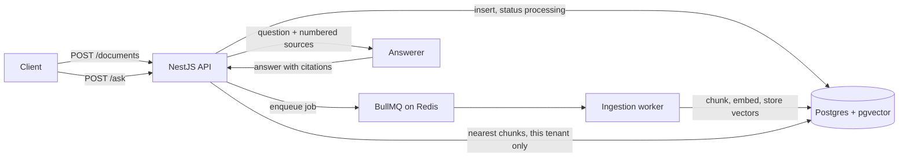

# Sourced

Ask questions about your documents and get answers that cite their sources. Multi-tenant, with an evaluation suite that runs in CI.

Sourced is a small, readable version of the patterns I use in production document Q&A work: background ingestion, retrieval scoped by tenant, answers that must cite a source or say they don't know, and an evaluation suite that turns "the answers look fine" into numbers. That production code belongs to clients, so this is the public version.

**Stack:** NestJS, TypeScript, PostgreSQL with pgvector, Redis with BullMQ, OpenAI (optional), Jest, GitHub Actions.

## How it works



1. **Upload.** `POST /documents` stores the text and returns `202` right away. A job goes on the queue.
2. **Ingest.** A worker splits the text into chunks on paragraph boundaries, embeds them in batches and stores the vectors. The document moves from `processing` to `ready`, or to `failed` after three attempts with backoff.
3. **Ask.** `POST /ask` embeds the question, fetches the five nearest chunks for that tenant only, and gives them to the answerer as numbered sources. The answer must cite them as `[n]`. The response lists only the sources the answer actually used.

## Quickstart

```bash
docker compose up -d postgres redis
cd api && cp .env.example .env && npm install
npm run tenant:create -- "Demo Co"     # prints an API key once
npm run start:dev                      # http://localhost:3001
```

```bash
KEY=sk_...   # from tenant:create

curl -H "x-api-key: $KEY" -H 'Content-Type: application/json' \
  -d '{"title":"Leave policy","content":"Everyone gets 24 days of paid annual leave per year."}' \
  localhost:3001/documents

curl -H "x-api-key: $KEY" -H 'Content-Type: application/json' \
  -d '{"question":"How many days of annual leave do we get?"}' \
  localhost:3001/ask
```

```json
{
  "answer": "Everyone gets 24 days of paid annual leave per year. [1]",
  "citations": [{ "n": 1, "documentId": "7c98…", "title": "Leave policy", "chunk": 0, "snippet": "…" }],
  "latencyMs": 3
}
```

Or run everything in containers with `docker compose up --build`. Set `AI_PROVIDER=openai` and `OPENAI_API_KEY` for real embeddings and answers.

## API

| Method | Path | What it does |
| --- | --- | --- |
| `POST` | `/documents` | Store a document and queue it for indexing. Returns `202` |
| `GET` | `/documents` | List this tenant's documents with status and chunk count |
| `GET` | `/documents/:id` | One document's status |
| `DELETE` | `/documents/:id` | Delete a document and its chunks |
| `POST` | `/ask` | Answer a question with citations |
| `GET` | `/health` | Health check, no key needed |

Every route except `/health` needs an `x-api-key` header.

## Design decisions

**Tenant isolation is enforced in SQL.** Every query filters by `tenant_id`, including the vector search, so another tenant's chunk can never reach the prompt. An end-to-end test checks this: tenant B can't list, read, delete or get answers from tenant A's documents. For an AI product, leaking one customer's documents to another is the worst failure there is, so it's tested directly rather than assumed.

**API keys are stored as SHA-256 hashes.** The plain key is shown once at creation. A leaked database doesn't leak working keys.

**Ingestion is a background job.** Embedding a long document takes seconds and can fail on provider errors, so it doesn't belong in the request. The job ID is the document ID, so a duplicate enqueue is ignored. Chunks are replaced inside one transaction, so a retry never leaves duplicates or half a document.

**Answers must cite or refuse.** The prompt allows only the numbered sources and requires a fixed "not found" reply when they don't contain the answer. Distant chunks are dropped before the model sees them. The response returns only the citations the answer used.

**Two AI providers behind one interface.** `local` is a hashed bag-of-words embedder and an extractive answerer: no network, no key, the same output every run. CI and the eval suite use it, so they're fast, free and reproducible. `openai` uses `text-embedding-3-small` and `gpt-4o-mini`. Both produce 1536-dimension vectors, so the schema never changes.

**Thin controllers, rules in services.** DTOs and the global `ValidationPipe` reject bad input before any code runs (unknown fields included). A global guard requires a tenant key on every route unless it's marked `@Public()`.

## Evaluation

`npm run eval` loads a fictional company handbook (`eval/corpus`) into a fresh tenant and asks 16 questions (`eval/questions.json`), including three whose answers aren't in the documents. It scores:

- **Retrieval:** is the right document in the top 5?
- **Answers:** does the answer contain the expected fact and cite the right document?
- **Refusals:** does it say "not found" instead of making something up?

The run fails when a score drops below its threshold, so a change to chunking, prompts or models that hurts quality fails CI. The full report is uploaded as a build artifact.

Current results with the offline `local` provider:

| Metric | Score | Threshold |
| --- | --- | --- |
| Retrieval: right document in top 5 | 100% | 90% |
| Answers: correct and cites the right document | 85% | 80% |
| Refusals: says "not found" when the answer isn't there | 100% | 100% |

The two misses show why lexical matching isn't enough. "How long does standard freight delivery take?" fails because the document says "delivered", not "delivery". "How many days of paid annual leave do employees get?" picks the sick-leave sentence, because it matches "employees get" word for word while the right sentence says "employee gets". Semantic embeddings and a real model fix both, which is what the eval exists to prove when you switch providers: `AI_PROVIDER=openai npm run eval`.

## Tests

```bash
npm test            # unit: chunking, local embedder and answerer
npm run test:e2e    # end to end against real Postgres and Redis: auth, validation, ingestion, citations, tenant isolation
npm run eval        # quality thresholds
```

CI runs lint, type checks, both test suites and the eval on every push.

## Known limits and next steps

- **Filtered vector search.** pgvector applies the tenant filter after the HNSW index scan, so a tenant with few chunks among many could get fewer than five results. Fine at this size. At scale: pgvector's iterative index scans, or a partition per large tenant.
- **One insert per chunk.** Fine up to a few hundred chunks per document. Batch with `unnest()` beyond that.
- **The worker runs in the API process.** Move it to its own entrypoint when ingestion needs to scale separately.
- **Text only.** PDF and DOCX parsing would go in the worker.
- **Next:** a Next.js front end, streaming answers over SSE, routing simple questions to a single cheap pass and harder ones to a multi-step flow, and per-tenant rate limits.

---

Built by [Muhammad Bin Javed](https://www.linkedin.com/in/mbj05).
